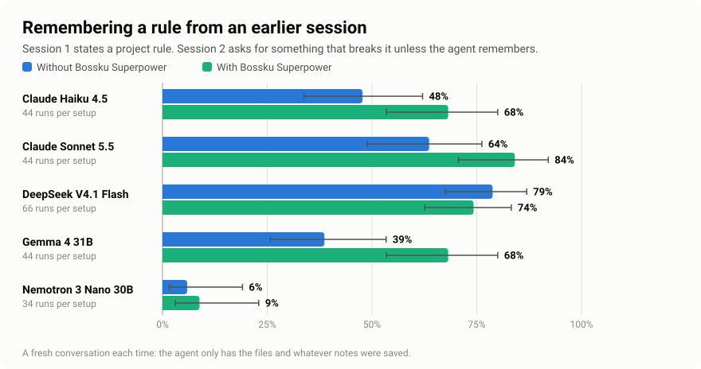

# Bossku Superpowers

> **Skills tell your AI coding agent what to do. Bossku checks that it did.**

Most skill packs only give your agent advice. Bossku also checks the work. It sends the agent back when it skips testing, stops commands that destroy work, and remembers the rules you gave it last time.

Free and open source ([MIT](LICENSE)). Works with **Claude Code, Codex, Cursor, OpenCode and OMP**. Works best in Claude Code.

**Website:** [wankimmy.github.io/Bossku-Superpowers](https://wankimmy.github.io/Bossku-Superpowers/)

*Formerly BosskuAI. The `bossku` command, the `bosskuai-*` skill names and the `~/.bosskuai` folder are the same, so your skills, hooks and notes still work. If you installed the plugin from a marketplace, reinstall it once.*


## Why Bossku

1. **It checks the work.** If the agent changed code and never ran a test, lint, build or the code itself, Bossku sends it back once.
2. **It stops costly mistakes.** `git reset --hard`, a plain force push, `rm -rf ~` and similar are refused. `git push`, a PR merge, `npm publish` and deploys wait for your yes.
3. **It remembers your rules.** The agent saves the rules and decisions you give as notes. The next session starts with the newest ones. Every 50 tool calls, useful lessons become small skills.
4. **One install, all your tools.** The same skills go to Claude Code, Codex, Cursor, OpenCode and OMP.
5. **Tested in public.** We publish the numbers, including where Bossku does not win.

## Is it better than other skill packs?

On 29 October 2026 we ran Bossku, four other packs and plain Claude Code on the same tasks, on the same day, with Claude Haiku 4.5 and Claude Sonnet 5.5.

| Setup | Remembered the rule next session (44 tasks) | Coding tasks passed (34) | Cost per run vs no pack |
|---|---|---|---|
| **Bossku** | **33 (75%)** | 32 | +38% to +42% |
| No pack | 23 (52%) | 32 | |
| ECC | 22 (50%) | 31 | +80% to +90% |
| Anthropic skills | 22 (50%) | 32 | +6% |
| Superpowers | 20 (45%) | 31 | +13% to +26% |
| Karpathy guidelines | 20 (45%) | 31 | -3% to +4% |

- **Bossku wins on remembering your rules.** It passed more two-session tasks than every other setup. The gap is unlikely to be luck (p 0.04 or lower against each).
- **Nobody wins on coding.** All six passed 31 or 32 of 34. These tasks are easy for these models.
- **It costs more.** About 40% more per run than no pack.

To be fair to the others: Superpowers, Karpathy's guidelines and Anthropic's skills are not built to remember rules between sessions. ECC is, but its hooks did not start on this Windows machine. `CLAUDE.md` and Claude Code's own memory were off for everyone. The tasks are Bossku's own, and each ran once. Full method and limits: [pack comparison](docs/benchmarks/results-2026-10-29-packs.md).

## Does it help on its own?

We also ran real agents on the same tasks with and without Bossku.



- **Memory: the clearest gain.** When a rule was set in one session and needed in the next, Claude Haiku 4.5 (48% → 68%), Claude Sonnet 5.5 (64% → 84%) and Gemma 4 31B (39% → 68%) passed 20 to 30 points more tasks. DeepSeek V4.1 Flash (79% → 74%) and Nemotron 3 Nano 30B (6% → 9%) showed no clear change.
- **Weak models test more.** Small Nemotron passed 37 of 40 sampled HumanEval problems with Bossku, and 25 of 40 without (the runs without were on other days).
- **Picking the right skill.** A good skill ranked first 81% of the time on 158 new requests, against 56% for plain keyword search. AI models, not people, judged which skills were good.
- **The cost: tokens.** About 1.0× to 4.7× the tokens per run, highest on models that checked the least before.
- **Coding pass rate: no clear change** for the three open models tested.

Before you trust the numbers:

- "Without" means no Bossku, no `CLAUDE.md` and Claude Code's own memory off. So the memory result is Bossku against **no memory**, not against Claude Code's own memory or a rule you wrote in `CLAUDE.md`. The Claude runs still used the tester's own Claude Code config (20 skills and 2 plugins).
- Skill picking was compared with keyword search, not with Claude Code's own choice. With a real agent, a good skill was opened for 45% of 60 requests.
- The agent runs used build `b8ccea1`, whose stop check also reminded the agent to save rules. Today's install uses a simpler check ([details](docs/memory.md#automatic-remembering)).

Full numbers: [benchmark results](docs/benchmarks/results.md) and the [10 October run](docs/benchmarks/results-2026-10-10.md). How we tested: [benchmark notes](docs/benchmarks/README.md).

## What Claude Code already does

Bossku builds on what Claude Code already has. Here is what is built in and what Bossku adds.

| Area | Built into Claude Code | What Bossku adds |
|---|---|---|
| Skills | Loads a skill when its description fits | 670+ skills (most from other open-source packs, credited), plus a hint that names the right ones |
| Memory | `CLAUDE.md` files and its own auto memory | Notes per project shown at session start, Obsidian sync, auto-learn |
| Ask before push | Permission rules you write yourself | A ready-made rule set, also for Cursor, Codex and OpenCode |
| Run your code | Stop hooks you write yourself | The check itself: one push back if code changed and nothing ran after |
| Subagents | Supported | Seven ready role contracts, also for Codex, Cursor, OpenCode and Devin |

Good to know:

- **The guard only sees the command the agent types.** A push hidden inside a script (`bash push.sh`) is not seen.
- **The security line is a format check.** When a turn changed code, the agent must write a `Security gate:` line. Bossku checks the line is there, not that a real review happened. It does not run a scanner.
- **Claude Code gets the most.** The guard also runs in Codex, Cursor and OpenCode, but there it is only unit-tested, not yet tried inside those apps. OMP gets the skills only.

## Quick start

You need **Python 3.11+** and **Git**.

1. **Get it.** `git clone https://github.com/wankimmy/Bossku-Superpowers`, then `cd Bossku-Superpowers` and `pip install -e .` (if `bossku` is not found, use `python -m bossku`).
2. **Set up your machine.** `bossku install` copies the skills, adds the subagents and turns on the hooks. For notes in Obsidian, add `--vault "/path/to/your/Obsidian/Vault" --memory-storage obsidian`.
3. **Set up a project.** `cd /path/to/your/project`, then `bossku init .`.
4. **Check it.** `bossku doctor --project .` prints `doctor: ok` or tells you what to fix.
5. **Work as usual.** No magic word. The hooks run on their own. Most of the time you will not notice them, until one stops a mistake.

### Turn things off

| To turn off | Do this |
|---|---|
| The run-your-code check | `BOSSKU_STOP_GATE=off` |
| Ask-before-push (for an approved autonomous loop) | `BOSSKU_GUARD_ASK=off` |
| Auto-learn | `BOSSKU_AUTO_LEARN=off` |
| Reading Codex's session files | `BOSSKU_RESUME=off` |
| Most safety gates | `bossku install --no-harness`; the Python verify gate stays, so also set `BOSSKU_VERIFY_GATE=0` |
| All hooks | `bossku hooks uninstall` (also turn off the Bossku plugin if you enabled it in Claude Code) |
| Everything | `bossku uninstall --purge` (project files and your notes stay) |

Every hook and its switch: [`hooks/`](hooks/README.md). Other switches are in [AGENTS.md](AGENTS.md).

### More choices

- **Where are my notes?** In `.bossku/memory` inside the project, unless you chose Obsidian.
- **Want more skills listed?** A first install lists 28 (`--profile lean`). Use `--profile core` for a small set, `--profile engineering` for all but marketing, or `--profile full` for all 258 listable skills. The other 416 sit in a library that `bossku skills find` searches.
- **Claude Code cutting skill descriptions?** On the full profile, `bossku doctor` warns you, and `bossku install --fit-skill-list` fixes it ([details](docs/installation.md#skill-list-budget-claude-code)).
- **Other tools?** Setup for [Claude Code](docs/installation.md#claude-code), [Cursor](docs/installation.md#cursor), [Codex](docs/installation.md#codex), [OpenCode](docs/installation.md#opencode), [OMP](docs/installation.md#omp) or [portable mode](docs/installation.md#portable-mode-cloudshared-repos).

## What's inside

| Part | What it is |
|---|---|
| **670+ skills** | Short checklists for engineering, product, design, security, marketing and founder work: 258 listable, 416 in a searchable library |
| **Helper hooks** | Name the right skills for your request, and show your newest notes when a Claude Code session starts |
| **Safety gates** | Refuse destructive commands, ask before push, merge, publish or deploy, check the syntax of written files, and send the agent back if it never ran its code. [Details](hooks/README.md) |
| **Subagents** | Seven roles: orchestrator, researcher, planner, designer, executor, auditor, final-reviewer |
| **Resume** | When Codex hits its usage limit, open Claude Code in the same folder and say "continue". Only thread ids and times are kept, in `~/.bosskuai/resume-state.json` |
| **Tools** | Optional programs like Headroom, Graft and MarkItDown. Installed only when you say yes |
| **Memory** | Your rules, decisions and lessons, one folder per project, optionally in Obsidian |

## Your notes in Obsidian


The agent saves a note when a future session would need it: a decision, a plan, a fact or a lesson. It decides this itself, so a note can be missed. Common secret patterns are blanked out (a pattern list, not a guarantee). Auto-learn may keep short quotes from your session as evidence in a learned skill. After each session the notes are **copied** to your vault; your originals stay put. If the vault is missing, Bossku tells you the note was not saved.

```bash
bossku remember --project . --kind decision "Use the existing test runner for this project."
bossku memory-brief --project .       # newest notes
bossku vault sync --project .         # sync to the vault now
bossku vault tidy                     # preview a clean-up (nothing changes)
```

More in [memory and Obsidian](docs/memory.md).

## Common commands

| Command | What it does |
|---|---|
| `bossku skills find "<task>"` | Show which skill fits and why (`--brief`: one line per skill) |
| `bossku skills show <id>` | Print one skill |
| `bossku tools list` | See optional tools and what's installed |
| `bossku tools install <tool>` | Show the plan for a tool. Add `--yes` to run it |
| `bossku init <project>` | Set up a project (`--portable` puts the skills inside it) |
| `bossku hooks install` / `uninstall` | Add or remove the hooks |
| `bossku resume` | Show the brief of a Codex task that hit its usage limit |
| `bossku doctor --project .` | Check your setup |
| `bossku update` | Refresh installed skills (run after `git pull`) |

## For contributors

```bash
python -m bossku skills index --root .   # only if a skill or routing input changed
python -m bossku validate --root .
python -m unittest discover -s tests -v
```

The website lives in [`web/`](web/) and [`.github/workflows/pages.yml`](.github/workflows/pages.yml) publishes it to GitHub Pages.

## Learn more

- [Skills](skills/) and [shared instructions](AGENTS.md)
- [Benchmark results](docs/benchmarks/results.md), [the pack comparison](docs/benchmarks/results-2026-10-29-packs.md) and [how they were measured](docs/benchmarks/README.md)
- [Third-party packs and credits](docs/third-party.md), plus [optional requirements](requirements-optional.txt)

## License

[MIT](LICENSE). Skills from other packs keep their own licenses: see [third-party](docs/third-party.md).
